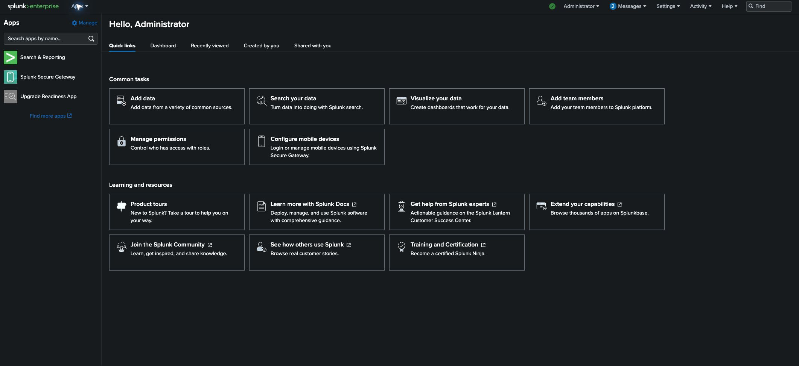
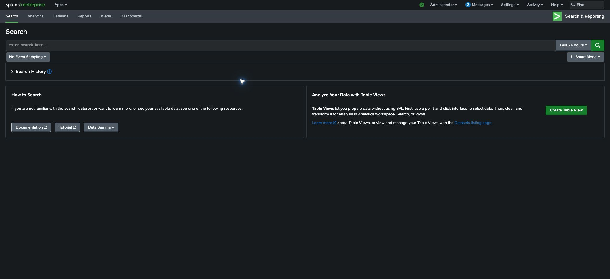
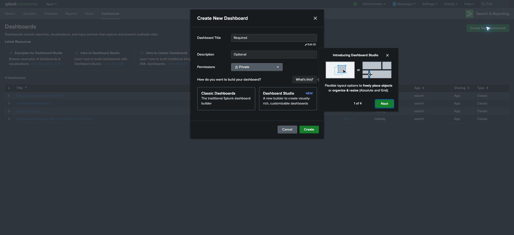
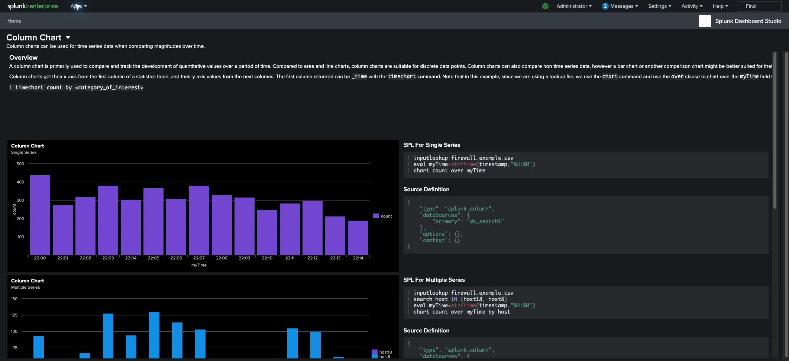

# Splunk UI analysis — installed 9.2.2 instance

Inspection date: October 24, 2026 (America/New_York). Target: `http://localhost:8000`; installation: `/Applications/Splunk`.

## What this documents

This report maps the installed UI and records **57 signed-in browser states** as screenshots and accessibility snapshots. It covers the launcher, every top-level Settings destination, Search & Reporting, Analytics, Dashboard Studio examples, app management and global menus. The accompanying catalog enumerates all **260 XML view definitions**, **13 navigation files**, **96 top-level Enterprise JavaScript bundles**, **185 templates**, and **35 controller source files** found in the inventory.

This is a full navigation and installed-view reference with broad live screen coverage. It is not an exhaustive test of every nested form, table page, role, deployment mode or data-dependent workflow. Counts of installed files are not counts of distinct accessible screens.

- [Complete installed-view catalog](splunk-ui-catalog.md)
- [Machine-readable installed inventory](splunk-ui-inventory.json)
- [REA evidence for login and core UI modules](splunk-full-ui-rea-evidence.json)
- [Earlier REA Dashboard Studio evidence](splunk-rea-evidence.json)

## Interface structure

The shared header provides the Splunk home logo, app switcher, health indicator, account menu, messages, Settings, Activity, Help and Find. The observed installation uses dark surfaces, light text, green Splunk branding, blue selected-state accents, bordered cards, dense administrative tables and flyout menus. Launcher and Analytics use larger panel layouts; legacy settings pages use conventional headings, tables and forms.

### Launcher

Application sidebar, app search, common-task cards, and learning resources. Five tabs: Quick links, Dashboard, Recently viewed, Created by you, and Shared with you.

Common-task cards link to Add data, Search your data, Visualize your data, Add team members, Manage permissions and Configure mobile devices. The app sidebar is narrower than the full app manager: visibility in the app switcher is not equivalent to installation.

### Search and analysis

| Screen | Observed interface |
|---|---|
| [Search](splunk-ui/search.jpg) | SPL editor, time selection, Search button, event sampling, Smart Mode, Search History, Data Summary, and table-view entry point. The captured state is before submitting a search. |
| [Search Time Picker](splunk-ui/search-time-picker.jpg) | Presets include real-time windows, relative dates, recent time windows, and All time. Separate sections expose Relative, Real-time, Date Range, Date & Time Range, and Advanced controls. |
| [Datasets](splunk-ui/datasets.jpg) | Dataset listing with table-based navigation and per-row action menus. This is the rendered listing, not validation of every dataset. |
| [Analytics Workspace](splunk-ui/analytics-workspace.jpg) | Data panel with Metrics, Datasets, and Alerts sections; filters, data-ingestion and chart time controls, split-by, layout, global actions, chart grid and Analysis panel. Initial chart controls are disabled until data is selected. |
| [Reports](splunk-ui/reports.jpg) | 10 reports in the captured Search & Reporting listing. Scope filters All/Yours/This App’s, text filter, expand rows, Open in Search and Edit controls; columns include scheduled time, owner, app, and sharing. |
| [Alerts](splunk-ui/alerts.jpg) | 0 alerts in the captured Search & Reporting listing. Scope and text filters remain available; table includes ownership, sharing and status. |
| [Dashboards](splunk-ui/dashboards.jpg) | 4 dashboards in the Search & Reporting app listing. Scope filter, text search, expandable rows, edit actions and dashboard type. Links to Studio examples and Classic dashboard help. |
| [Create Dashboard Dialog](splunk-ui/create-dashboard-dialog.jpg) | Title, ID editing, description, permissions, and Classic versus Dashboard Studio selection. Cancel/Create actions. The dialog was inspected and cancelled without creating an object. |
| [Jobs](splunk-ui/jobs.jpg) | Job Manager with owner/app/event/size/created/expiry/runtime/status/action columns. Observed no matching results in the current app context. |
| [Triggered Alerts](splunk-ui/triggered-alerts.jpg) | Triggered-alert listing with filtering and columns for name, app, type, severity, mode and actions. Captured empty state is scoped to the current app. |

### Dashboard Studio

Examples organized into chart elements, gauges, single values, tables, spatial/design elements, trellis, data sources, defaults, inputs, interactions/tokens and complete dashboards.

Live column-chart examples render Highcharts interactive charts and provide JSON Source Definition blocks. Observed definitions include splunk.column, primary data-source references, and stacked/stacked100 options. Charts completed loading; this does not validate every example.

### Global menus

| Menu | Observed entries |
|---|---|
| [Apps Menu](splunk-ui/apps-menu.jpg) | Visible app switcher shows Search & Reporting, Splunk Secure Gateway and Upgrade Readiness App, plus Manage Apps and Find More Apps. |
| [Account Menu](splunk-ui/account-menu.jpg) | Account Settings, Preferences and Logout. Logout was not invoked. |
| [Settings Menu](splunk-ui/settings-menu.jpg) | Five main groups: Knowledge, System, Data, Distributed Environment, Users and Authentication, plus Add Data and Monitoring Console shortcuts. |
| [Activity Menu](splunk-ui/activity-menu.jpg) | Jobs and Triggered Alerts, with separate open-in-new-window actions. Their URLs inherit the current application namespace. |
| [Help Menu](splunk-ui/help-menu.jpg) | What’s New, Tutorials, Splunk Answers, Contact Support, File a Bug, page help, privacy, About and documentation search. External destinations were not opened. |

### Every top-level Settings destination

Routes below were read from the live Settings menu in the Search app. App-scoped manager routes change with the current app; `/manager/search/...` and `/manager/launcher/...` are context variants rather than necessarily distinct screens. Every destination below was opened, and its observed state was captured.

| Destination | Menu route | Observed UI |
|---|---|---|
| [Add Data](splunk-ui/add-data.jpg) | `/en-US/manager/search/adddata` | Add-data entry point offers uploading data, monitoring files/ports on the local instance, and forwarding from a Splunk forwarder. No upload or input configuration was submitted. |
| [Monitoring Console](splunk-ui/monitoring-console.jpg) | `/en-US/app/splunk_monitoring_console/monitoringconsole_overview` | Standalone monitoring overview identifies Splunk Enterprise Server 9.2.2. Panels include process/resource and KV Store information; some were waiting for data. Alerts explicitly require setup. |
| [Searches, reports, and alerts](splunk-ui/searches-reports-and-alerts.jpg) | `/en-US/manager/search/saved/searches` | Administrative saved-object listing. App, ownership and object-type scope differ from the end-user Reports and Alerts listings. Captured filters scope to Search and Administrator. |
| [Data models](splunk-ui/data-models.jpg) | `/en-US/manager/search/data_model_manager` | Data-model manager listing with edit and Pivot actions and ownership/sharing metadata. |
| [Event types](splunk-ui/event-types.jpg) | `/en-US/manager/search/saved/eventtypes` | Event-type listing exposes status, permissions, clone, move and delete controls. No object action was submitted. |
| [Tags](splunk-ui/tags.jpg) | `/en-US/manager/search/tags` | See the screenshot and snapshot. |
| [Fields](splunk-ui/fields.jpg) | `/en-US/manager/search/fields` | Hub for field-related configuration, including extraction/transformation, field aliases/calculated fields, source-type renaming and workflow actions; links preserve app context. |
| [Lookups](splunk-ui/lookups.jpg) | `/en-US/manager/search/lookups` | Hub for lookup table files, lookup definitions, automatic lookups and GeoIP lookup file management. |
| [User interface](splunk-ui/user-interface.jpg) | `/en-US/manager/search/ui` | Configuration hub includes views, navigation menus, prebuilt panels and bulletin messages. |
| [Alert actions](splunk-ui/alert-actions.jpg) | `/en-US/manager/search/alert_actions` | Administrative alert-action listing with enable/disable, usage-statistics and log-event links. No delivery or webhook was invoked. |
| [Advanced search](splunk-ui/advanced-search.jpg) | `/en-US/manager/search/advancedsearch` | Hub for search macros and search-command permissions. |
| [All configurations](splunk-ui/all-configurations.jpg) | `/en-US/manager/search/admin/directory` | Administrative directory listing reports 298 items, with first-page results and pagination. Only the visible page was captured. |
| [Server settings](splunk-ui/server-settings.jpg) | `/en-US/manager/search/systemsettings` | Hub for general/server settings, internal library settings, email, logging, deployment client and search preferences. |
| [Server controls](splunk-ui/server-controls.jpg) | `/en-US/manager/search/control` | Restart Splunk control is visible. It was inspected without invoking restart. |
| [Health report manager](splunk-ui/health-report-manager.jpg) | `/en-US/manager/system/health/manager` | Health-feature table exposes Edit/Snooze controls, configuration provenance and enabled status. No feature was changed. |
| [Instrumentation](splunk-ui/instrumentation.jpg) | `/en-US/manager/splunk_instrumentation/instrumentation_index` | Instrumentation/diagnostic interface shows diagnostic table and creation entry point. Captured state: no diagnostics found; none were created. |
| [Licensing](splunk-ui/licensing.jpg) | `/en-US/manager/system/licensing` | Standalone license server using the Trial group. License status, expiration, daily volume, usage, warnings and links to license/indexer details. Login displayed an expired-license warning. |
| [Workload management](splunk-ui/workload-management.jpg) | `/en-US/manager/system/workload_management` | Admission Rules, Workload Pools and Workload Rules tabs. Captured initial state: Admission Rules Disabled; add-rule action available. |
| [Mobile settings](splunk-ui/mobile-settings.jpg) | `/en-US/app/splunk_secure_gateway/administration#/` | Secure Gateway onboarding explains Mobile/TV/AR. It displays terms and an administrator-contact message. Terms were not accepted and onboarding was not completed. |
| [Data inputs](splunk-ui/data-inputs.jpg) | `/en-US/manager/search/datainputstats` | Local and forwarded input catalogs include file, HTTP, TCP/UDP, script and other input entry points. Counts and Add new controls are part of the interface. |
| [Forwarding and receiving](splunk-ui/forwarding-and-receiving.jpg) | `/en-US/manager/search/forwardreceive` | Separate Forward data and Receive data sections; forwarding and receiving configuration links and Add new actions. |
| [Indexes](splunk-ui/indexes.jpg) | `/en-US/manager/search/data/indexes` | Index table includes type, app, sizes, event counts, paths, status and edit/disable/delete controls. Existing internal and summary indexes are visible. |
| [Report acceleration summaries](splunk-ui/report-acceleration-summaries.jpg) | `/en-US/manager/system/summarization` | Searchable summary listing. Captured empty state: no report acceleration summaries. |
| [Source types](splunk-ui/source-types.jpg) | `/en-US/manager/search/sourcetypes` | Source-type listing supports filtering and per-row edit/clone with category and app metadata. |
| [Ingest actions](splunk-ui/ingest-actions.jpg) | `/en-US/manager/search/ingest_rulesets` | Rulesets and Destinations tabs with Deploy and New Ruleset entry points. No deployment or ruleset creation was performed. |
| [Indexer clustering](splunk-ui/indexer-clustering.jpg) | `/en-US/manager/system/clustering` | Introduction and Enable indexer clustering control indicate clustering has not been enabled through this screen. No enable action was taken. |
| [Forwarder management](splunk-ui/forwarder-management.jpg) | `/en-US/manager/system/deploymentserver` | Observed empty state says no clients or apps are available on this deployment server. This deployment therefore does not show populated client/server-class details. |
| [Federated search](splunk-ui/federated-search.jpg) | `/en-US/manager/search/federated_search` | Federated Providers and Federated Indexes tabs; Add federated provider. Captured provider list is empty. |
| [Distributed search](splunk-ui/distributed-search.jpg) | `/en-US/manager/search/distsearch` | Hub for distributed-search setup and search peers, including Add new peer. |
| [Roles](splunk-ui/roles.jpg) | `/en-US/manager/search/authorization/roles` | Role listing with Edit menus and inheritance/capability information. Existing roles include built-in and system roles. |
| [Users](splunk-ui/users.jpg) | `/en-US/manager/search/authentication/users` | User listing with edit controls, authentication type, time zone, default app, roles, activity and status metadata. No user or role was changed. |
| [Tokens](splunk-ui/tokens.jpg) | `/en-US/manager/search/authorization/tokens` | Token Settings and New Token controls with an empty token listing. No token was created or revealed. |
| [Password management](splunk-ui/password-management.jpg) | `/en-US/manager/search/password/management` | Password-policy form includes complexity/expiration and account-lockout controls. Existing values were read; Save was not submitted. |
| [Authentication methods](splunk-ui/authentication-methods.jpg) | `/en-US/manager/search/authoverview` | Splunk, LDAP and SAML authentication choices and multifactor choices None/Duo/RSA; configuration reload control. No authentication change or reload was submitted. |

## Frontend architecture and evidence

The login capture directly observed a server-rendered document followed by requests for the Enterprise Bootstrap stylesheet, `/config?autoload=1`, localization scripts, `build/pages/enterprise/common.js`, `build/pages/enterprise/account.js`, Proxima fonts and Splunk icon fonts. This supports a server-rendered shell with browser-side UI bundles; it does not establish that every screen shares the same implementation.

The filesystem contains Python Splunk Web controllers and HTML/Mako-style templates alongside compiled page bundles. Installed app navigation XML declares app-local views. The earlier Dashboard Studio analysis observed ES module import/export relationships in selected shipped chunks. Exact backend authorization and search/index execution are outside this UI investigation.

REA analyzed **7 core page bundles** (`account`, `home`, `reports`, `alerts`, `apps_local`, `job_manager`, `deploymentserver`): 553,939 text bytes, 62,069 syntax nodes, 434 static findings, zero parse failures. Findings are observations, not vulnerabilities. The source selection excludes 125 other inventoried files; semantic graphs are partial and capped at 5,000 nodes per file and 40,000 overall. The very large search/shared bundles were inventoried, not completely analyzed.

Earlier REA analysis covered four Dashboard Studio chunks: CloneDashboard, DeeplinkDashboard, EditPermissions and ScheduledExport. Those selected files parsed successfully; shared implementation dependencies remained outside the selection.

| Evidence | Identity |
|---|---|
| REA live login scenario | `ev_3da57a6dd8cc5d6584ed6c052b0c40f46116a986af83a10985eb4a9917a00a5f` |
| REA core page analysis | `ev_e2abedfb14de67a8cd59d66219d7fbf3b3a3f97ad83f8bc745099728aa962f20` |
| REA core summary | `ev_9b35f33e6614b00dc63249f9b0d0f4e02432ed1234d611f5321ce91c96405c4c` |
| REA Dashboard Studio analysis | `ev_a4179b19643dde7bc7bc520aae64eb74df24da85297141522a0f0f3a0911c713` |

Post-login screenshots and accessibility snapshots were collected through the connected Chrome browser. They are browser observations, **not REA Evidence records**. They use the user’s signed-in Administrator session. REA’s login capture used a separate temporary browser profile and was closed after capture.

## Coverage limits and current deployment states

- The login page reported an expired license. The signed-in Licensing page identifies a Trial group and 0 MB daily licensed volume. No license was changed.
- Monitoring Console shows Standalone mode and an alert-setup requirement; some panels were waiting for data during capture.
- Forwarder Management has no clients or deployment apps, so populated deployment details could not be observed.
- Federated providers, tokens, report acceleration summaries and the selected Jobs/Triggered Alerts listings were empty. These states are scoped to the captured instance and app.
- A top-level page capture does not verify every subtab, pagination result, creation/edit dialog, save path or validation error.
- Dashboard Studio’s column-chart example was observed live; every other example and editor action was not exercised. Classic dashboard editor internals were not exercised.
- Search was inspected before submitting a query. Search-result rendering, statistics, visualizations, export, job cancellation and save-as behavior remain unverified at runtime.
- The inventory includes monitoring variants and example views that may be hidden, legacy, configuration-dependent or unavailable under another role.
- Native decompilation was not required for this UI map. The earlier Mach-O inspection encountered missing `dyld_info`; no native internals are claimed here.
- No settings were saved, no objects or tokens created, no uploads performed, and no restart, deployment or destructive action invoked. The optional dashboard tour was skipped to expose the listing.

## Screenshot and observation index

Each snapshot records the visible controls and links at capture time. Screenshots capture the viewport, so offscreen content is documented in the accessibility snapshot and link inventory where available.

| State | Screenshot | Accessibility snapshot | Notes |
|---|---|---|---|
| Account Menu | [Image](splunk-ui/account-menu.jpg) | [Text](splunk-ui/account-menu.txt) | Account Settings, Preferences and Logout. Logout was not invoked. |
| Activity Menu | [Image](splunk-ui/activity-menu.jpg) | [Text](splunk-ui/activity-menu.txt) | Jobs and Triggered Alerts, with separate open-in-new-window actions. Their URLs inherit the current application namespace. |
| Add Data | [Image](splunk-ui/add-data.jpg) | [Text](splunk-ui/add-data.txt) | Add-data entry point offers uploading data, monitoring files/ports on the local instance, and forwarding from a Splunk forwarder. No upload or input configuration was submitted. |
| Advanced Search | [Image](splunk-ui/advanced-search.jpg) | [Text](splunk-ui/advanced-search.txt) | Hub for search macros and search-command permissions. |
| Alert Actions | [Image](splunk-ui/alert-actions.jpg) | [Text](splunk-ui/alert-actions.txt) | Administrative alert-action listing with enable/disable, usage-statistics and log-event links. No delivery or webhook was invoked. |
| Alerts | [Image](splunk-ui/alerts.jpg) | [Text](splunk-ui/alerts.txt) | 0 alerts in the captured Search & Reporting listing. Scope and text filters remain available; table includes ownership, sharing and status. |
| All Configurations | [Image](splunk-ui/all-configurations.jpg) | [Text](splunk-ui/all-configurations.txt) | Administrative directory listing reports 298 items, with first-page results and pagination. Only the visible page was captured. |
| Analytics Workspace | [Image](splunk-ui/analytics-workspace.jpg) | [Text](splunk-ui/analytics-workspace.txt) | Data panel with Metrics, Datasets, and Alerts sections; filters, data-ingestion and chart time controls, split-by, layout, global actions, chart grid and Analysis panel. Initial chart controls are disabled until data is selected. |
| App Management | [Image](splunk-ui/app-management.jpg) | [Text](splunk-ui/app-management.txt) | App table with folder name, version, update checking, visibility, sharing and status; launch, properties, permissions, disable and object links. Presence of a control does not establish that its action was executed. |
| Apps Menu | [Image](splunk-ui/apps-menu.jpg) | [Text](splunk-ui/apps-menu.txt) | Visible app switcher shows Search & Reporting, Splunk Secure Gateway and Upgrade Readiness App, plus Manage Apps and Find More Apps. |
| Authentication Methods | [Image](splunk-ui/authentication-methods.jpg) | [Text](splunk-ui/authentication-methods.txt) | Splunk, LDAP and SAML authentication choices and multifactor choices None/Duo/RSA; configuration reload control. No authentication change or reload was submitted. |
| Create Dashboard Dialog | [Image](splunk-ui/create-dashboard-dialog.jpg) | [Text](splunk-ui/create-dashboard-dialog.txt) | Title, ID editing, description, permissions, and Classic versus Dashboard Studio selection. Cancel/Create actions. The dialog was inspected and cancelled without creating an object. |
| Dashboard Studio Column Chart | [Image](splunk-ui/dashboard-studio-column-chart.jpg) | [Text](splunk-ui/dashboard-studio-column-chart.txt) | Live column-chart examples render Highcharts interactive charts and provide JSON Source Definition blocks. Observed definitions include splunk.column, primary data-source references, and stacked/stacked100 options. Charts completed loading; this does not validate every example. |
| Dashboard Studio Example Hub | [Image](splunk-ui/dashboard-studio-example-hub.jpg) | [Text](splunk-ui/dashboard-studio-example-hub.txt) | Examples organized into chart elements, gauges, single values, tables, spatial/design elements, trellis, data sources, defaults, inputs, interactions/tokens and complete dashboards. |
| Dashboards | [Image](splunk-ui/dashboards.jpg) | [Text](splunk-ui/dashboards.txt) | 4 dashboards in the Search & Reporting app listing. Scope filter, text search, expandable rows, edit actions and dashboard type. Links to Studio examples and Classic dashboard help. |
| Data Inputs | [Image](splunk-ui/data-inputs.jpg) | [Text](splunk-ui/data-inputs.txt) | Local and forwarded input catalogs include file, HTTP, TCP/UDP, script and other input entry points. Counts and Add new controls are part of the interface. |
| Data Models | [Image](splunk-ui/data-models.jpg) | [Text](splunk-ui/data-models.txt) | Data-model manager listing with edit and Pivot actions and ownership/sharing metadata. |
| Datasets | [Image](splunk-ui/datasets.jpg) | [Text](splunk-ui/datasets.txt) | Dataset listing with table-based navigation and per-row action menus. This is the rendered listing, not validation of every dataset. |
| Distributed Search | [Image](splunk-ui/distributed-search.jpg) | [Text](splunk-ui/distributed-search.txt) | Hub for distributed-search setup and search peers, including Add new peer. |
| Event Types | [Image](splunk-ui/event-types.jpg) | [Text](splunk-ui/event-types.txt) | Event-type listing exposes status, permissions, clone, move and delete controls. No object action was submitted. |
| Federated Search | [Image](splunk-ui/federated-search.jpg) | [Text](splunk-ui/federated-search.txt) | Federated Providers and Federated Indexes tabs; Add federated provider. Captured provider list is empty. |
| Fields | [Image](splunk-ui/fields.jpg) | [Text](splunk-ui/fields.txt) | Hub for field-related configuration, including extraction/transformation, field aliases/calculated fields, source-type renaming and workflow actions; links preserve app context. |
| Forwarder Management | [Image](splunk-ui/forwarder-management.jpg) | [Text](splunk-ui/forwarder-management.txt) | Observed empty state says no clients or apps are available on this deployment server. This deployment therefore does not show populated client/server-class details. |
| Forwarding And Receiving | [Image](splunk-ui/forwarding-and-receiving.jpg) | [Text](splunk-ui/forwarding-and-receiving.txt) | Separate Forward data and Receive data sections; forwarding and receiving configuration links and Add new actions. |
| Health Report Manager | [Image](splunk-ui/health-report-manager.jpg) | [Text](splunk-ui/health-report-manager.txt) | Health-feature table exposes Edit/Snooze controls, configuration provenance and enabled status. No feature was changed. |
| Help Menu | [Image](splunk-ui/help-menu.jpg) | [Text](splunk-ui/help-menu.txt) | What’s New, Tutorials, Splunk Answers, Contact Support, File a Bug, page help, privacy, About and documentation search. External destinations were not opened. |
| Home | [Image](splunk-ui/home.jpg) | [Text](splunk-ui/home.txt) | Application sidebar, app search, common-task cards, and learning resources. Five tabs: Quick links, Dashboard, Recently viewed, Created by you, and Shared with you. |
| Home Created By You | [Image](splunk-ui/home-created-by-you.jpg) | [Text](splunk-ui/home-created-by-you.txt) | Knowledge-object table and create-dashboard link. Observed empty state for the selected object type. |
| Home Dashboard | [Image](splunk-ui/home-dashboard.jpg) | [Text](splunk-ui/home-dashboard.txt) | Shows “Choose a home dashboard” in the observed account. The chooser was not used to change the home dashboard. |
| Home Recently Viewed | [Image](splunk-ui/home-recently-viewed.jpg) | [Text](splunk-ui/home-recently-viewed.txt) | Knowledge-object table with Name, Owner, Updated, App, Sharing, filtering, and object-type selection. Observed empty state. |
| Home Shared With You | [Image](splunk-ui/home-shared-with-you.jpg) | [Text](splunk-ui/home-shared-with-you.txt) | Paginated shared knowledge-object table. The captured Dashboard selection reports 163 dashboards, 20 on the first page. This is a runtime listing, distinct from the 260 installed XML definitions. |
| Indexer Clustering | [Image](splunk-ui/indexer-clustering.jpg) | [Text](splunk-ui/indexer-clustering.txt) | Introduction and Enable indexer clustering control indicate clustering has not been enabled through this screen. No enable action was taken. |
| Indexes | [Image](splunk-ui/indexes.jpg) | [Text](splunk-ui/indexes.txt) | Index table includes type, app, sizes, event counts, paths, status and edit/disable/delete controls. Existing internal and summary indexes are visible. |
| Ingest Actions | [Image](splunk-ui/ingest-actions.jpg) | [Text](splunk-ui/ingest-actions.txt) | Rulesets and Destinations tabs with Deploy and New Ruleset entry points. No deployment or ruleset creation was performed. |
| Instrumentation | [Image](splunk-ui/instrumentation.jpg) | [Text](splunk-ui/instrumentation.txt) | Instrumentation/diagnostic interface shows diagnostic table and creation entry point. Captured state: no diagnostics found; none were created. |
| Jobs | [Image](splunk-ui/jobs.jpg) | [Text](splunk-ui/jobs.txt) | Job Manager with owner/app/event/size/created/expiry/runtime/status/action columns. Observed no matching results in the current app context. |
| Licensing | [Image](splunk-ui/licensing.jpg) | [Text](splunk-ui/licensing.txt) | Standalone license server using the Trial group. License status, expiration, daily volume, usage, warnings and links to license/indexer details. Login displayed an expired-license warning. |
| Lookups | [Image](splunk-ui/lookups.jpg) | [Text](splunk-ui/lookups.txt) | Hub for lookup table files, lookup definitions, automatic lookups and GeoIP lookup file management. |
| Mobile Settings | [Image](splunk-ui/mobile-settings.jpg) | [Text](splunk-ui/mobile-settings.txt) | Secure Gateway onboarding explains Mobile/TV/AR. It displays terms and an administrator-contact message. Terms were not accepted and onboarding was not completed. |
| Monitoring Console | [Image](splunk-ui/monitoring-console.jpg) | [Text](splunk-ui/monitoring-console.txt) | Standalone monitoring overview identifies Splunk Enterprise Server 9.2.2. Panels include process/resource and KV Store information; some were waiting for data. Alerts explicitly require setup. |
| Password Management | [Image](splunk-ui/password-management.jpg) | [Text](splunk-ui/password-management.txt) | Password-policy form includes complexity/expiration and account-lockout controls. Existing values were read; Save was not submitted. |
| Report Acceleration Summaries | [Image](splunk-ui/report-acceleration-summaries.jpg) | [Text](splunk-ui/report-acceleration-summaries.txt) | Searchable summary listing. Captured empty state: no report acceleration summaries. |
| Reports | [Image](splunk-ui/reports.jpg) | [Text](splunk-ui/reports.txt) | 10 reports in the captured Search & Reporting listing. Scope filters All/Yours/This App’s, text filter, expand rows, Open in Search and Edit controls; columns include scheduled time, owner, app, and sharing. |
| Roles | [Image](splunk-ui/roles.jpg) | [Text](splunk-ui/roles.txt) | Role listing with Edit menus and inheritance/capability information. Existing roles include built-in and system roles. |
| Search | [Image](splunk-ui/search.jpg) | [Text](splunk-ui/search.txt) | SPL editor, time selection, Search button, event sampling, Smart Mode, Search History, Data Summary, and table-view entry point. The captured state is before submitting a search. |
| Search Time Picker | [Image](splunk-ui/search-time-picker.jpg) | [Text](splunk-ui/search-time-picker.txt) | Presets include real-time windows, relative dates, recent time windows, and All time. Separate sections expose Relative, Real-time, Date Range, Date & Time Range, and Advanced controls. |
| Searches Reports And Alerts | [Image](splunk-ui/searches-reports-and-alerts.jpg) | [Text](splunk-ui/searches-reports-and-alerts.txt) | Administrative saved-object listing. App, ownership and object-type scope differ from the end-user Reports and Alerts listings. Captured filters scope to Search and Administrator. |
| Server Controls | [Image](splunk-ui/server-controls.jpg) | [Text](splunk-ui/server-controls.txt) | Restart Splunk control is visible. It was inspected without invoking restart. |
| Server Settings | [Image](splunk-ui/server-settings.jpg) | [Text](splunk-ui/server-settings.txt) | Hub for general/server settings, internal library settings, email, logging, deployment client and search preferences. |
| Settings Menu | [Image](splunk-ui/settings-menu.jpg) | [Text](splunk-ui/settings-menu.txt) | Five main groups: Knowledge, System, Data, Distributed Environment, Users and Authentication, plus Add Data and Monitoring Console shortcuts. |
| Source Types | [Image](splunk-ui/source-types.jpg) | [Text](splunk-ui/source-types.txt) | Source-type listing supports filtering and per-row edit/clone with category and app metadata. |
| Tags | [Image](splunk-ui/tags.jpg) | [Text](splunk-ui/tags.txt) | Captured UI state. |
| Tokens | [Image](splunk-ui/tokens.jpg) | [Text](splunk-ui/tokens.txt) | Token Settings and New Token controls with an empty token listing. No token was created or revealed. |
| Triggered Alerts | [Image](splunk-ui/triggered-alerts.jpg) | [Text](splunk-ui/triggered-alerts.txt) | Triggered-alert listing with filtering and columns for name, app, type, severity, mode and actions. Captured empty state is scoped to the current app. |
| User Interface | [Image](splunk-ui/user-interface.jpg) | [Text](splunk-ui/user-interface.txt) | Configuration hub includes views, navigation menus, prebuilt panels and bulletin messages. |
| Users | [Image](splunk-ui/users.jpg) | [Text](splunk-ui/users.txt) | User listing with edit controls, authentication type, time zone, default app, roles, activity and status metadata. No user or role was changed. |
| Workload Management | [Image](splunk-ui/workload-management.jpg) | [Text](splunk-ui/workload-management.txt) | Admission Rules, Workload Pools and Workload Rules tabs. Captured initial state: Admission Rules Disabled; add-rule action available. |
